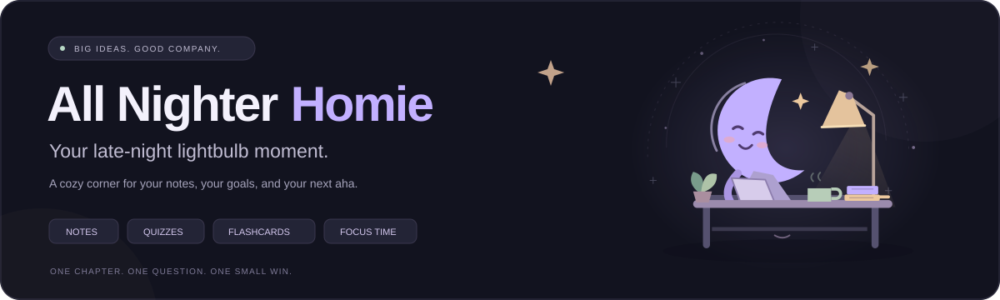

<div align="center">



### 🌙 Late night. Bright ideas. Good company.

Your notes, a little less overwhelming. Your next aha moment, a little closer. ✨

**[🚀 Open the app](https://all-nighter-homie.hp4277467.chatgpt.site)** &nbsp; · &nbsp; **[🧭 Quick start](#-your-first-small-win)** &nbsp; · &nbsp; **[🌐 Publish your own](PUBLISH-TO-GITHUB.md)**


</div>

---

## ☕ Meet your new study homie

A long syllabus. A tricky chapter. A brain with seventeen tabs open.

**All Nighter Homie** gives your study session a little structure and a lot more clarity. Bring your notes, pick a tool, and turn “I don't get this” into “wait… that makes sense.”

No app account. No installation. Just a cozy workspace that opens in your browser. 💜

> **Just looking around?** Tap **Meet your study homie** in the app. The sample lesson works without an API key, so you can try the study tools straight away.

## ✨ Same notes. New superpowers.

| | Your tool | Your next small win |
| :---: | :--- | :--- |
| 📝 | **My notes** | Paste, autosave, import text files, and export a backup. |
| 💡 | **Explain it** | Make a tricky topic click at beginner, high-school, or college level. |
| 🎯 | **Practice quiz** | Try 3, 5, or 10 questions with instant feedback and a running score. |
| 🃏 | **Flashcards** | Flip, recall, repeat — and keep track of what you remember. |
| 🗓️ | **Study plan** | Break your goal into 1, 2, 4, or 8 weeks of checkable daily tasks. |
| 💬 | **Ask your notes** | Talk through questions with an AI tutor grounded in your material. |
| ⏳ | **Focus room** | Settle into a 25-minute session, then take a proper break. |

## 🌗 A space that feels good to study in

| 🌙 Settle into the night | ☀️ Let a little light in |
| :--- | :--- |
| Deep midnight colours, soft lavender accents, and a friendly moon keeping you company. | A clean light theme for daytime sessions, with your preference remembered. |

- **📊 See your progress.** A learning snapshot brings your notes, quiz score, and flashcard recall together.
- **💾 Pick up where you left off.** Notes and generated study progress restore in the same browser after a reload.
- **📱 Bring any screen.** Responsive layouts work on laptops, tablets, and phones.
- **🔗 Bring a friend.** The Share button copies the app address so your homies can open their own workspace.
- **🫶 Take it at your pace.** Clear controls, keyboard access, and reduced-motion support keep things comfortable.

## 🚀 Your first small win

### 1. Make yourself at home 🏡

Open **[All Nighter Homie](https://all-nighter-homie.hp4277467.chatgpt.site)**. Try the sample lesson, or paste your own notes into **My notes**. You can also import a `.txt`, `.text`, or `.md` file.

### 2. Connect your AI homie 🔌

Open **Connect AI**, enter your own **[Groq API key](https://console.groq.com/keys)**, choose **Test connection**, then **Use these settings**.

> 🔑 Your key stays in tab memory and goes directly to Groq. Re-enter it after a reload. Each visitor uses their own key; the app does not include a shared key or free unlimited AI.

### 3. Pick your next step ✦

Need a simpler explanation? **Explain it.** Want to see what stuck? **Take a quiz.** Ready to settle in? **Open the focus room.**

One chapter. One question. One small win at a time.

## 🧑‍🤝‍🧑 Send a little homie energy

Share **[the live app](https://all-nighter-homie.hp4277467.chatgpt.site)** with a friend. They open it on their laptop or phone — no GitHub account, terminal, or Node.js installation needed.

Their notes stay in their browser. Their AI key stays in their tab. Sharing the app link does not share your study material. 🔒

Prefer a local copy? Download the project, unzip it, and double-click **`index.html`**. Keep the `assets` folder and the other app files beside it.

## 🌐 Give it a home on GitHub

Ready to make it part of your profile? The project includes a **GitHub Pages publishing workflow** that checks the code, runs the tests, and publishes the static app.

**[📖 Follow the step-by-step publishing guide →](PUBLISH-TO-GITHUB.md)**

For a repository named `All-Nighter-Homie` under `harshitCorteX`, the Pages address will be:

```text
https://harshitcortex.github.io/All-Nighter-Homie/
```

> 📌 This GitHub Pages address becomes live after the files are uploaded, Pages is enabled, and deployment succeeds. The hosted app linked at the top is available separately. Keeping the older `AI-Study-Buddy` repository name keeps that name in its Pages URL.

---

## 🛠️ Under the cozy hood

Plain **HTML, CSS, and JavaScript** power the interface. **Groq** handles AI requests. Browser storage remembers notes and progress. No framework or runtime package installation is needed to use the app.

<details>
<summary><strong>💻 Run locally, check the code, and build</strong></summary>

For a consistent localhost origin, use **Node.js 20.19+** and start the optional development server:

```sh
npm start
```

Open **[localhost:4173](http://localhost:4173)**. The server binds only to localhost; set the `PORT` environment variable if that port is already in use.

For development checks and a static bundle:

```sh
npm ci --ignore-scripts
npm run check
npm test
npm run build
```

The build lands in **`dist/`**. The app has **zero runtime dependencies**; the DOM tests use `linkedom` as a development dependency.

**✅ 28 automated tests** cover response validation, interrupted streams, study flows, note migration, progress restoration, safe text rendering, themes, focus controls, and sharing. AI responses are mocked in tests; use **Test connection** with your key to check real Groq access.

</details>

<details>
<summary><strong>🔒 Your notes, your key, your browser</strong></summary>

- **Notes, progress, and theme** are saved in your browser's `localStorage`.
- **Your API key and chat history** stay in tab memory and clear on reload.
- **AI requests** send the relevant prompt, selected notes, and conversation directly to [Groq](https://console.groq.com/docs/api-reference).
- **Share** copies only the app address, without notes, messages, or API keys.
- **Offline caching** stores only public app files; it does not cache Groq calls or keys.
- **Editing notes** resets old generated results and chat context. Export a backup before replacing material you want to keep.
- **Different browsers and hostnames** have separate storage. Notes do not automatically sync between the live app, GitHub Pages, localhost, and local files.

Existing notes from the original AI Study Buddy are retained when using the same browser origin. If storage is blocked or full, export a backup.

</details>

<details>
<summary><strong>🧠 A few useful things to know</strong></summary>

- **Sample mode** uses labelled, prepared responses about photosynthesis and makes no AI requests.
- **AI features** require an internet connection and your own Groq key. Answers can contain mistakes; check important material against your course notes.
- **File imports** support `.txt`, `.text`, and `.md` up to **200 KB**. For PDF or Word documents, paste their text instead.
- **Notes** support up to **200,000 characters**. Longer material uses up to **12,000 characters of selected excerpts** per request, with a visible status message. Topic matches are prioritised; splitting large documents into chapters improves coverage.
- **Requests** support cancellation, a 90-second timeout, validated quiz/plan responses, and helpful recovery messages.
- **Offline use** is available for the hosted interface after a successful first online visit. Notes and prepared samples can work offline; live AI cannot. The app-shell cache requires HTTPS or localhost.
- **Coming back** is as simple as bookmarking the link. Browsers that support installation may also offer **Install** or **Add to home screen**.

</details>

<details>
<summary><strong>🗂️ Find your way around the project</strong></summary>

```text
All-Nighter-Homie/
├── index.html                 # Workspace and dialogs
├── styles.css                 # Midnight/light themes and responsive layouts
├── app.js                     # Study flows and local interactions
├── core.js                    # Groq transport and response validation
├── assets/                    # Moon mascot, desk illustration, README banner
├── manifest.webmanifest       # App metadata
├── sw.js                      # Public-interface offline cache
├── server.cjs                 # Optional local development server
├── build.cjs                  # Static bundle preparation
├── tests/                     # Core and DOM integration tests
├── .github/workflows/         # Checks and GitHub Pages publishing
├── PUBLISH-TO-GITHUB.md        # Upload, deploy, and share instructions
└── IBM_BOB_USAGE.md            # Original project's tooling notes
```

</details>

---

<div align="center">

### 🌙 Keep the curiosity. Take the break. Come back brighter.

Made for your lightbulb moments, one small win at a time. 💜

**[✨ Start a study session](https://all-nighter-homie.hp4277467.chatgpt.site)**

</div>
